> COPIE en lecture seule — source : [DOSSIER_PROJET]/00_ritual/Architecture_Projet.md, version du 2026-11-12. Ne pas modifier ici : une correction se propose au §6 de PASSATION.md.

# ARCHITECTURE PROJET — Capstone_Project_1

> - Ressources utilisées : `Document_Maitre.md` v1.0, `Matrice_Conformite.md` v1.0, `Banque_Questions.md` v1.0, `Features_Complet.md` v1.0,
>   `Syllabus_Mapping.md` v1.0 ; `01_Architecture_Globale.md` (§2bis), `02_Architecture_Globale_AI.md`, `03_Architecture_Globale_ML.md` ;
>   `02_BUILD/00_Build_Control.md` (précondition d'ouverture du build) ; énoncé du 18 octobre 2026 (§11, §13, §14, §16) · système v2.3.4
> - Contrôle indépendant réalisé par : aucun
> - Date : 2026-10-20 · Version : **v1.2** (2026-11-12) ; v1.1 (2026-11-04) — v1.0 **VALIDÉ par Erman le 2026-10-20** (v0.1 : même contenu) · Confidentialité : document INTERNE
> - **Changement de la v1.2** (2026-11-12, décision d'Erman I45) : §3bis — FAILED atteignable depuis **tous les états non finaux** (ajout de VALIDATED → FAILED et HUMAN_REVIEW → FAILED), pour suivre l'énoncé §11.3 « Any step -> FAILED ».
> - **Changements de la v1.1** (écart de fond, règle C18 — décision d'Erman I20, 2026-11-04) : le seuil et les bornes des bandes ont **une seule source**, `model_metadata.json` (D-12) ; `configs/settings.yaml` (n° 06) ne garde que les réglages d'exploitation ; `risk_bands.py` (n° 40) reçoit les bornes en paramètre au lieu de les lire dans la configuration.
>
> (Les décisions encore ouvertes ne se répètent pas ici — elles vivent uniquement en section 9.)

> **Choix techniques tranchés par Erman le 2026-10-20** : interface **Streamlit** ; deep learning **PyTorch** ; stockage **SQLite + fichier JSON des preuves** ;
> LLM **au choix, n'importe quel modèle** — d'où un adaptateur unique au protocole compatible OpenAI, réglé par configuration (§4, D-04).

> Diagrammes en Mermaid. **Le diagramme illustre, il ne décide pas** : le registre (§8) et les tableaux font foi.

---

## 1. SCHÉMA DES COUCHES — Capstone_Project_1

Noms des couches : ceux des projets IA (`02_Architecture_Globale_AI.md` §2), repris tels quels par `Syllabus_Mapping.md` v1.0 —
**1 Data · 2 Ingestion/Parser · 3 Logic Engine · 4 LLM Interpreter + orchestrateur · 5 UI**.
Le **pipeline d'entraînement** est hors couches (`03_Architecture_Globale_ML.md` §2) : il produit les artefacts que la couche 2 relit.

### 1.1 Diagramme de composants 
#### Vue d'ensemble
 
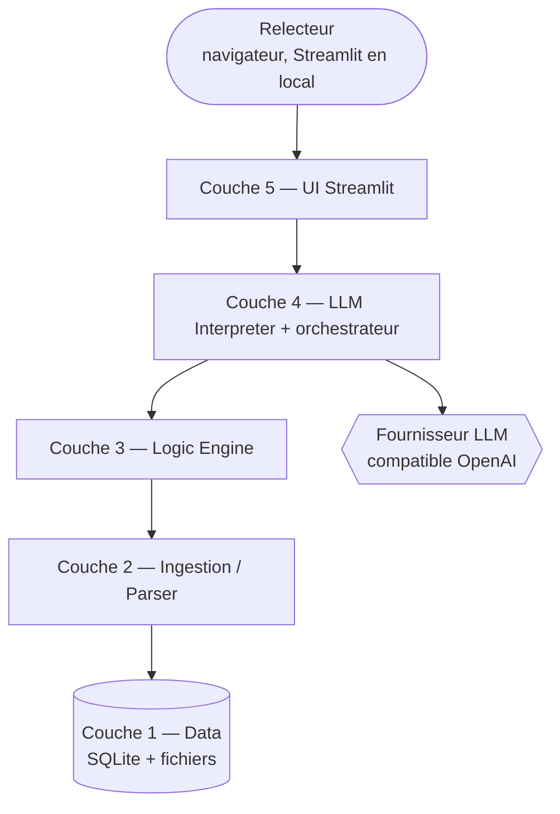
 
> Chaque flèche descend d'une couche, ou reste dans la même couche. Seule la couche 4 parle au LLM (D-03). La couche 5 ne parle qu'à l'orchestrateur ; `app/ui_components.py` ne fait que de l'affichage.
 
#### Détail — couches 5 et 4 (UI, orchestrateur, LLM)
 
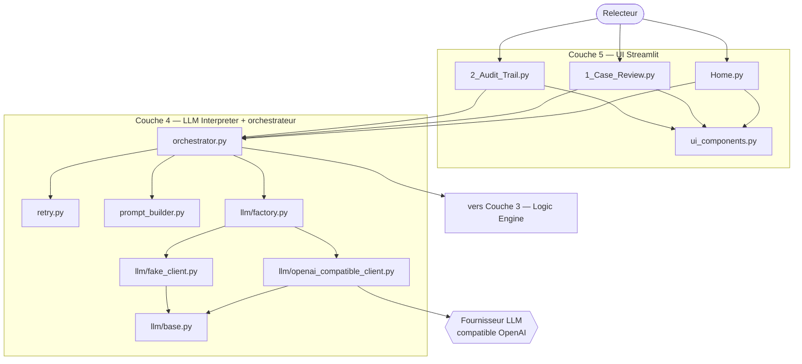
 
#### Détail — couche 3 (Logic Engine) vers la couche 2
 
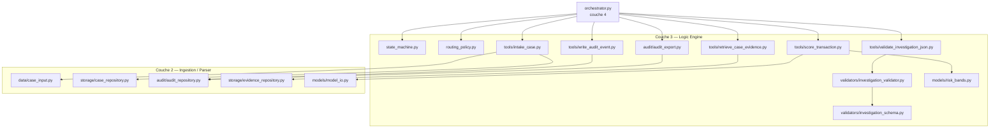
 
#### Détail — couches 2 vers 1 (stockage)
 
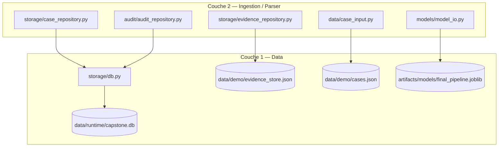
> Chaque flèche descend d'une couche, ou reste dans la même couche. Seule la couche 4 parle au LLM (D-03). La couche 5 ne parle qu'à
> l'orchestrateur ; `app/ui_components.py` ne fait que de l'affichage.

### 1.2 Ce que chaque couche fait
| Couche | Fichiers principaux (registre §8) | Connaît uniquement | Ne fait jamais |
|---|---|---|---|
| 5 — UI | `app/Home.py`, `app/pages/1_Case_Review.py`, `app/pages/2_Audit_Trail.py`, `app/ui_components.py` | L'orchestrateur (couche 4) | Appeler la base, un outil, le modèle ou le LLM directement ; calculer une bande ou une priorité |
| 4 — LLM Interpreter + orchestrateur | `src/agent/orchestrator.py`, `retry.py`, `prompt_builder.py`, `llm/*` (4 fichiers nommés au §8) | Les outils et règles de la couche 3 ; le fournisseur LLM via l'adaptateur | Calculer le score, la bande ou la validation ; écrire en base sans passer par un outil |
| 3 — Logic Engine | `state_machine.py`, `routing_policy.py`, les 5 outils, le validateur, `risk_bands.py`, `audit_export.py` | Les fichiers de la couche 2 | Appeler le LLM ; connaître Streamlit |
| 2 — Ingestion/Parser | `case_input.py`, `case_repository.py`, `audit_repository.py`, `evidence_repository.py`, `model_io.py` | Les fichiers et la base de la couche 1 | Décider (score, bande, validité d'un brouillon) |
| 1 — Data | `src/storage/db.py`, `data/runtime/capstone.db`, `data/demo/*.json`, `artifacts/models/*` | Personne | Toute logique — stocke et récupère |

---

## 2. STACK TECHNIQUE VALIDÉE

| Couche | Technologie | Fichier principal | Pourquoi ce choix |
|--------|-------------|-------------------|-------------------|
| UI | Streamlit (multipage, `st.session_state`, `st.download_button`) | `app/Home.py` | Choix d'Erman (2026-10-20) ; les 12 éléments de l'énoncé §13 se font sans JavaScript ; export de l'audit natif |
| 4 — LLM Interpreter + orchestrateur | Python ; SDK `openai` utilisé **comme client du protocole compatible OpenAI** (adresse, modèle, clé dans `.env`) ; orchestrateur écrit à la main, sans framework d'agent | `src/agent/orchestrator.py` | « On doit pouvoir brancher les modèles qu'on veut » (Erman) : un seul adaptateur couvre OpenRouter, Ollama, vLLM, LM Studio, Groq, Together… Orchestrateur maison : l'énoncé préfère une machine à états déterministe (§11.2), et tout est défendable à l'oral |
| 3 — Logic Engine | Python ; Pydantic v2 (schéma du brouillon) ; scikit-learn (application du pipeline) | `src/agent/validators/investigation_validator.py` | Validation déterministe, séparée du LLM (§10.3) ; Pydantic donne les champs requis et les types |
| 2 — Ingestion/Parser | Python ; `sqlite3` (bibliothèque standard) ; `joblib` | `src/storage/case_repository.py` | Rien à installer ; une seule couche connaît le SQL |
| Data | SQLite (un fichier local, non versionné) ; JSON (cas et preuves de démo, versionnés) ; artefacts du modèle | `src/storage/db.py` | Choix d'Erman ; la contrainte d'unicité sur la clé d'idempotence bloque les doublons au niveau de la base (D-07) |
| Infrastructure (hors couches) | Environnement Python local (`venv`) ; `requirements.txt` aux versions épinglées ; pas de Docker ni de serveur | `requirements.txt` | L'énoncé demande une app locale reproductible depuis le README (§15 A) |
| Entraînement ML (hors couches) | pandas, scikit-learn (Pipeline, ColumnTransformer, LogisticRegression, RandomForest, HistGradientBoosting en option), **PyTorch** (MLP), matplotlib / seaborn, SHAP **ou** importance par permutation (D-11), joblib | `src/train.py` | Imposé ou conseillé par l'énoncé (§6–§9) ; PyTorch, choix d'Erman : la boucle d'entraînement reste visible |

---

## 3. FLUX DE DONNÉES — comment une requête voyage de A à Z

### Flux 1 — Cas normal, de la réception jusqu'à la décision du relecteur
### Flux 1 — Cas normal, de la réception jusqu'à la décision du relecteur

#### Version présentation

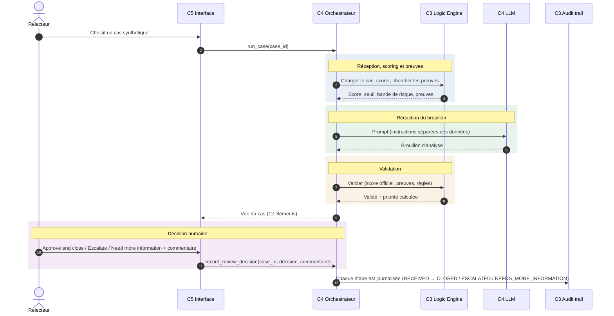

#### Version détail (référence technique)

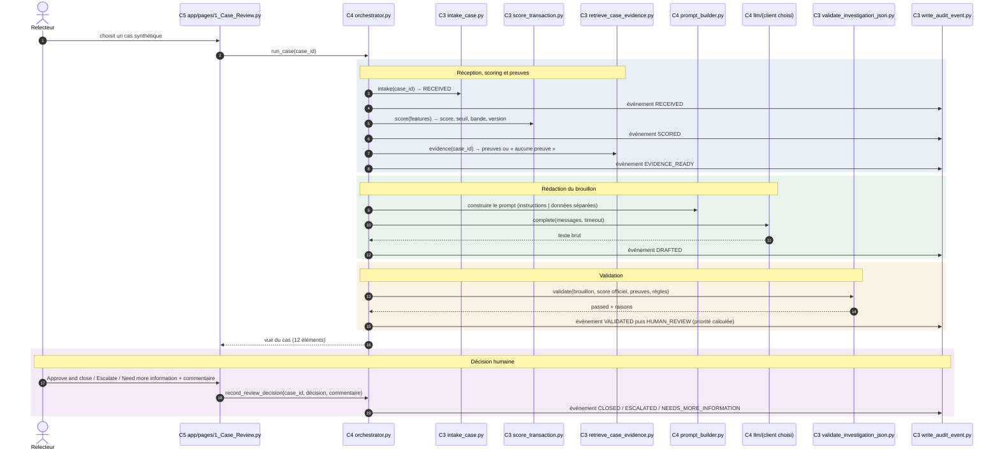

### Flux 2 — Brouillon rejeté, puis panne d'outil (les deux cas de la vidéo)
### Flux 2 — Brouillon rejeté, puis panne d'outil (les deux cas de la vidéo)

#### Flux 2a — Brouillon rejeté (version présentation)

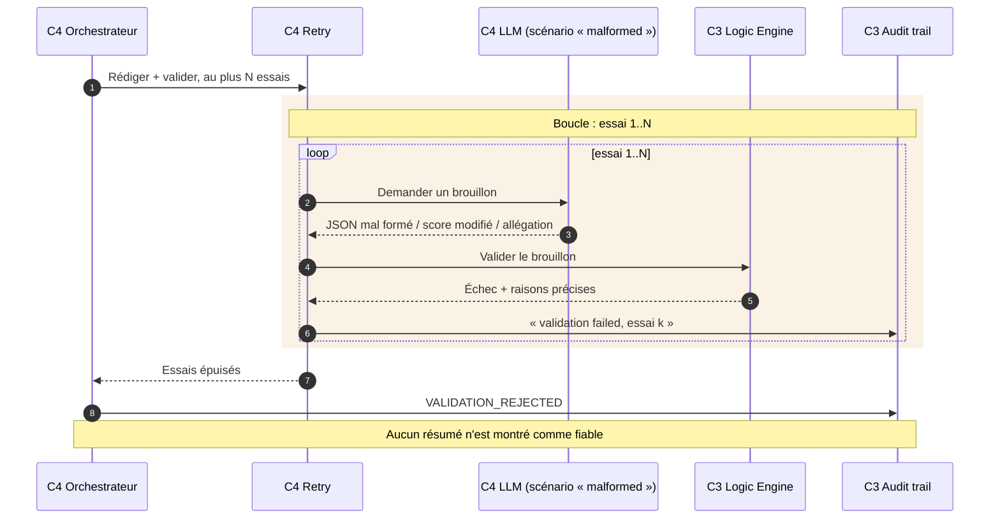

#### Flux 2a — Brouillon rejeté (version détail)

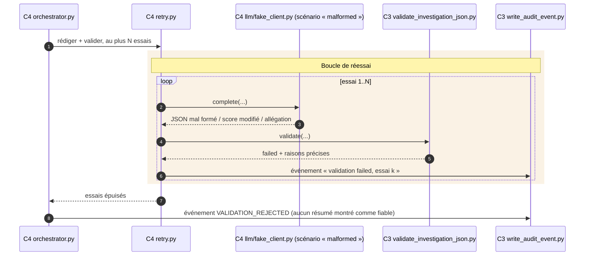

#### Flux 2b — Panne d'outil (version présentation)

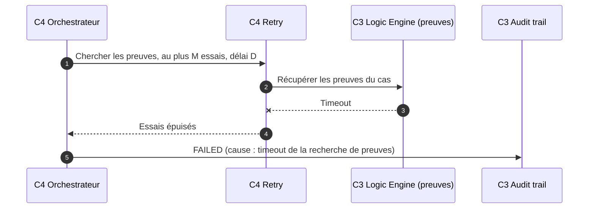

#### Flux 2b — Panne d'outil (version détail)

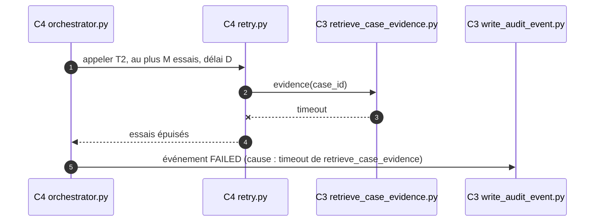

---

## 3bis. CYCLES DE VIE — DIAGRAMMES D'ÉTATS

### Cas d'enquête (`cases.state`)
### Machine à états d'un cas

#### Version présentation

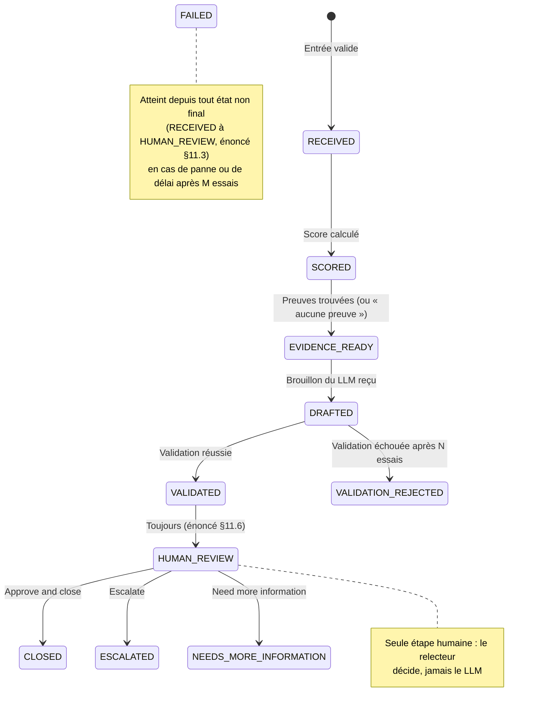

États finaux : `CLOSED`, `ESCALATED`, `NEEDS_MORE_INFORMATION`, `VALIDATION_REJECTED` et `FAILED`.

#### Version détail (référence technique)

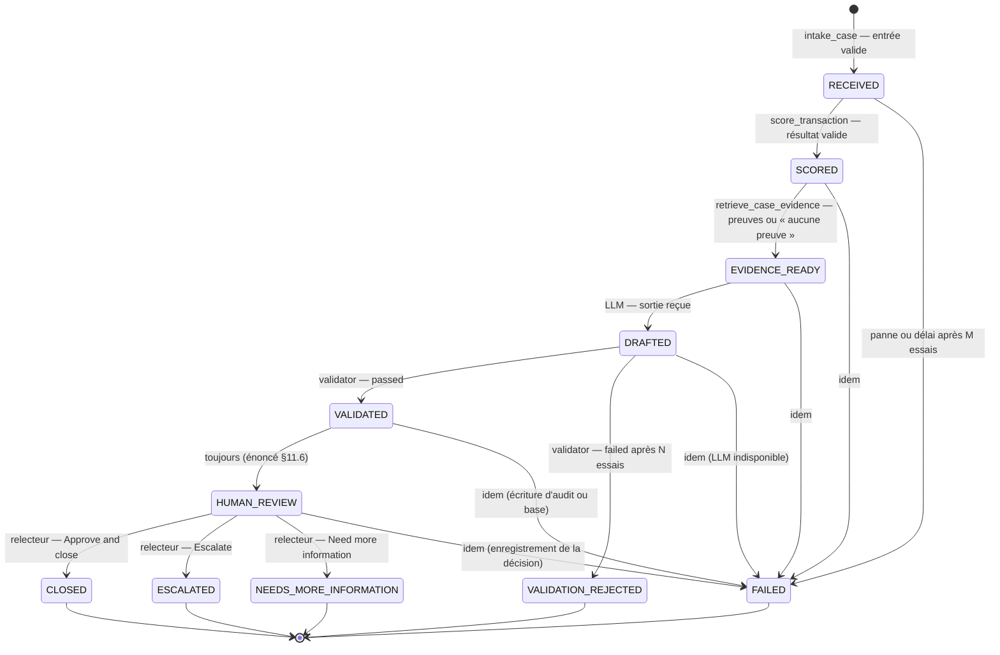
| Transition | Déclenchée par (rôle ou tâche) | Service qui l'applique | Test |
|---|---|---|---|
| (création) → RECEIVED | Orchestrateur, après `intake_case` | `src/agent/state_machine.py` | `tests/test_state_machine.py::test_valid_path` |
| RECEIVED → SCORED | `score_transaction` réussi | `state_machine.py` | idem |
| SCORED → EVIDENCE_READY | `retrieve_case_evidence` (y compris un résultat vide explicite) | `state_machine.py` | idem + `tests/test_tools.py::test_unknown_case_returns_empty` |
| EVIDENCE_READY → DRAFTED | Sortie du LLM reçue (lisible ou non : c'est le validateur qui juge) | `state_machine.py` | `tests/test_orchestrator.py::test_normal_case_reaches_human_review` |
| DRAFTED → VALIDATED | Validateur : passed | `state_machine.py` | idem |
| DRAFTED → VALIDATION_REJECTED | Validateur : failed après N essais | `state_machine.py` | `tests/test_orchestrator.py::test_rejected_after_bounded_retries` |
| VALIDATED → HUMAN_REVIEW | Toujours | `state_machine.py` | `tests/test_orchestrator.py::test_validated_always_goes_to_review` |
| HUMAN_REVIEW → CLOSED / ESCALATED / NEEDS_MORE_INFORMATION | Relecteur | `state_machine.py` | `tests/test_review_and_audit.py::test_review_decision_recorded` |
| RECEIVED / SCORED / EVIDENCE_READY / DRAFTED / VALIDATED / HUMAN_REVIEW → FAILED (énoncé §11.3 « Any step », I45) | Panne ou délai après M essais | `state_machine.py` | `tests/test_orchestrator.py::test_tool_timeout_leads_to_failed` |
| **Interdite** : RECEIVED → VALIDATED (et toute transition absente du tableau) | — | `state_machine.py` lève `InvalidTransitionError`, et l'audit l'enregistre | `tests/test_state_machine.py::test_invalid_transition_rejected` |
| **Interdite** : toute sortie d'un état final | — | idem | `tests/test_state_machine.py::test_terminal_states_are_final` |

---

## 4. DÉCISIONS TRANCHÉES POUR CE PROJET

| Décision | Pourquoi |
|----------|----------|
| **D-01** Streamlit pour l'interface | Choix d'Erman, 2026-10-20 |
| **D-02** PyTorch pour le MLP | Choix d'Erman, 2026-10-20 ; boucle d'entraînement explicite, défendable (Banque B63) |
| **D-03** Seule la couche 4 appelle le LLM ; le LLM ne calcule jamais le score, la bande, la priorité ni la validité | `02_Architecture_Globale_AI.md` §2 ; énoncé §10.4, §11.6 (Banque B31) |
| **D-04** LLM « au choix » : une interface `LLMClient` (`llm/base.py`) et **un adaptateur unique au protocole compatible OpenAI** (`base_url`, `model`, `api_key` dans `.env`), plus un faux client. Le choix se fait par configuration (`LLM_PROVIDER=fake\|openai_compatible`) | Demande d'Erman : brancher n'importe quel modèle. Un seul adaptateur suffit, car la plupart des fournisseurs et des serveurs locaux parlent ce protocole. Ajouter un fournisseur qui ne le parle pas = un fichier de plus derrière la même interface (§6) |
| **D-05** Faux client à scénarios (`valid`, `malformed`, `missing_field`, `score_mismatch`, `unsupported_evidence`, `prohibited_claim`, `timeout`) ; il sert aux tests **et** à la démo des échecs | Énoncé §10.5 (tests sans réseau) et §15 E (montrer un cas d'échec dans la vidéo) |
| **D-06** Orchestrateur écrit à la main = machine à états déterministe avec un appel LLM, sans framework d'agent | Énoncé §11.2 ; moins de dépendances ; tout est explicable (Banque B30, B32) |
| **D-07** Idempotence : clé `"{case_id}:{step}"`, clé primaire de la table `step_results`. Une étape déjà réussie n'est pas rejouée : son résultat stocké est rendu. Un cas déjà soumis n'est pas recréé (`cases.case_id` clé primaire) | Énoncé §11.6, §14 « duplicate submissions » (Banque B34) |
| **D-08** Nouvelles tentatives et délais maximaux dans un seul module (`retry.py`), avec les valeurs dans `configs/settings.yaml` : outils M = 2 nouvelles tentatives, délai 5 s ; LLM 2 nouvelles tentatives après rejet, délai 30 s (**valeurs de départ**, voir §9 P-05) | Énoncé §11.1, §11.6 (Banque B33) ; une seule implémentation, testée une fois |
| **D-09** Les preuves sont **dérivées des variables de la transaction, jamais de `isFraud` ni de `isFlaggedFraud`** ; elles sont générées par `scripts/build_demo_cases.py` avec un ID de source unique (`EV-xxxx`) | Sinon les preuves feraient fuir la cible jusqu'au LLM et au relecteur (anti-fuite, DM §8.5) |
| **D-10** Cas de démo = lignes du **jeu de test** (jamais de l'entraînement), sans l'étiquette. Champ `case_note` synthétique facultatif ; au moins un cas contient une note piégée (injection de prompt) | Énoncé §10.3, §12 (test avec une note piégée) ; pas de score flatteur sur des données déjà vues |
| **D-11** Explicabilité : importance par permutation (toujours), et SHAP seulement si son installation et sa durée de calcul passent au J3 | Énoncé §8.5 : un des deux suffit ; risque d'installation et de temps |
| **D-12** Le pipeline sauvegardé (prétraitement + modèle) et ses métadonnées (`model_metadata.json` : nom, version, date d'entraînement, seuil, bornes des bandes) sont chargés par `model_io.py` ; **`model_metadata.json` est la source unique du seuil et des bornes** (v1.1, I20 : le seuil est un produit de l'entraînement et voyage avec le modèle) ; le service ne refait **jamais** le prétraitement à la main | `03_Architecture_Globale_ML.md` §2 ; énoncé §7.2, §13 élément 4 |
| **D-13** Code partagé entre l'entraînement et le service : `src/features/build_features.py` doit être importable au chargement du pipeline (transformateurs personnalisés) | Condition technique de joblib ; à défaut, le chargement échoue |
| **D-14** Paquets Python sans `__init__.py` (paquets d'espace de noms) ; `pyproject.toml` règle `pythonpath` pour pytest | Moins de fichiers vides dans le registre ; imports stables `src.…` |
| **D-15** Ce qui n'est pas versionné : `data/raw/`, `data/runtime/`, `.env`, `artifacts/models/` ; ce qui est versionné : `data/demo/*.json`, `artifacts/metrics/`, `artifacts/figures/` | Énoncé §3.1, §16 (pas de données brutes) ; le README régénère le modèle (§15 A) |
| **D-16** Langue : code, interface, README et documents rendus en anglais | `Document_Maitre.md` §8.9 |

---

### POINTS D'ENTRÉE ET COUCHES MÉTIER
> Voir aussi `01_Architecture_Globale.md` pour la règle générale.

Les points d'entrée valident l'entrée et appellent le service autorisé ; ils ne contiennent pas de logique métier.

| Point d'entrée | Couche appelée | Interface d'exposition ou vraie couche ? |
|---|---|---|
| Pages Streamlit (`streamlit run app/Home.py`) | Couche 4 — `orchestrator.py` (fonctions publiques : `submit_case`, `run_case`, `get_case_view`, `list_review_queue`, `record_review_decision`, `get_audit_events`, `export_audit`) | Interface d'exposition (couche 5 = mise en forme seulement) |
| `python -m src.train` | Pipeline d'entraînement (hors couches) | Commande d'entraînement documentée (énoncé §7.2) |
| `python scripts/build_demo_cases.py` | Pipeline d'entraînement → écrit `data/demo/*.json` (couche 1) | Script de préparation des données de démo |
| `pytest` | Tous les fichiers testés | Outil, pas une couche |

---

## 5. CE QUI EST INTERDIT PAR COUCHE

| Couche | Interdit |
|--------|----------|
| UI | Appeler un outil, un dépôt, la base, le modèle ou le LLM ; calculer un score, une bande, une priorité ou une validité ; afficher un brouillon non validé comme fiable ; afficher une trace d'erreur brute ; toute formulation accusatrice |
| 4 — LLM Interpreter + orchestrateur | Calculer ou modifier le score officiel ; juger lui-même la validité du brouillon ; écrire en base sans passer par un outil ; mettre une note de cas dans la section des instructions ; toute action financière ; des tentatives sans limite |
| 3 — Logic Engine | Appeler le LLM ; importer Streamlit ; lire `isFraud` ou `isFlaggedFraud` ; offrir une action financière (outils en lecture seule ou limités à l'écriture d'audit et d'état) |
| 2 — Ingestion/Parser | Décider (score, bande, validité) ; écrire du SQL hors des dépôts ; journaliser un secret |
| Data | Toute logique — uniquement lire et écrire |
| Entraînement (hors couches) | Ajuster le prétraitement sur la validation ou le test ; rééchantillonner la validation ou le test ; évaluer sur le test plus d'une fois ; utiliser `isFlaggedFraud` dans le modèle principal |

---

## 6. OÙ AJOUTER QUOI QUAND LE PROJET GRANDIT

```
Tu veux changer de modèle LLM (n'importe lequel parlant le protocole compatible OpenAI) ?
→ .env seulement : LLM_BASE_URL, LLM_MODEL, LLM_API_KEY. Aucun fichier de code.

Tu veux un fournisseur qui ne parle PAS ce protocole ?
→ un fichier de plus : src/agent/llm/<fournisseur>_client.py, qui implémente LLMClient (llm/base.py),
  et une ligne dans llm/factory.py. L'orchestrateur et les tests ne changent pas.

Tu veux un nouvel outil (ex. historique du compte d'origine) ?
→ src/agent/tools/<outil>.py (couche 3) + son dépôt en couche 2 si besoin + un appel dans orchestrator.py
  + un état ou une transition dans state_machine.py SI le flux change + tests.

Tu veux une nouvelle règle de validation (ex. un nouveau mot interdit) ?
→ configs/prohibited_terms.yaml (mot) ou investigation_validator.py (règle) + un test dans tests/test_validator.py.

Tu veux changer le modèle de scoring ?
→ réentraîner (python -m src.train) : nouvel artefact + nouvelle version dans model_metadata.json.
  Le service et l'UI ne changent pas.

Tu veux passer en produit (Phase 2 : plusieurs utilisateurs, base serveur) ?
→ remplacer src/storage/db.py et les dépôts (couche 2) ; ajouter une API (Bloc 6 : FastAPI) comme nouveau point d'entrée
  devant l'orchestrateur. Les couches 3 et 4 ne changent pas.
```

---

## 7. ARBORESCENCE DU PROJET

```
capstone-project-1/
├── README.md
├── requirements.txt
├── pyproject.toml
├── .env.example
├── .gitignore
├── configs/
│   ├── settings.yaml
│   └── prohibited_terms.yaml
├── data/
│   ├── README.md
│   ├── raw/                      (non versionné — fichier PaySim téléchargé, voir README)
│   ├── runtime/                  (non versionné — capstone.db créé au lancement)
│   └── demo/
│       ├── cases.json
│       └── evidence_store.json
├── notebooks/
│   └── 01_eda.ipynb
├── scripts/
│   └── build_demo_cases.py
├── src/
│   ├── config.py
│   ├── logging_setup.py
│   ├── train.py
│   ├── data/
│   │   ├── schema.py
│   │   ├── load_paysim.py
│   │   ├── eda.py
│   │   ├── split.py
│   │   └── case_input.py
│   ├── features/
│   │   └── build_features.py
│   ├── models/
│   │   ├── model_io.py
│   │   ├── train_classical.py
│   │   ├── train_mlp.py
│   │   ├── evaluate.py
│   │   ├── threshold.py
│   │   ├── explain.py
│   │   └── risk_bands.py
│   ├── storage/
│   │   ├── db.py
│   │   ├── case_repository.py
│   │   └── evidence_repository.py
│   ├── audit/
│   │   ├── audit_repository.py
│   │   └── audit_export.py
│   └── agent/
│       ├── domain.py
│       ├── state_machine.py
│       ├── routing_policy.py
│       ├── retry.py
│       ├── prompt_builder.py
│       ├── orchestrator.py
│       ├── prompts/
│       │   └── investigation_summary_v1.md
│       ├── llm/
│       │   ├── base.py
│       │   ├── openai_compatible_client.py
│       │   ├── fake_client.py
│       │   └── factory.py
│       ├── tools/
│       │   ├── intake_case.py
│       │   ├── score_transaction.py
│       │   ├── retrieve_case_evidence.py
│       │   ├── validate_investigation_json.py
│       │   └── write_audit_event.py
│       └── validators/
│           ├── investigation_schema.py
│           └── investigation_validator.py
├── app/
│   ├── Home.py
│   ├── ui_components.py
│   └── pages/
│       ├── 1_Case_Review.py
│       └── 2_Audit_Trail.py
├── tests/
│   ├── conftest.py
│   ├── test_data_schema.py
│   ├── test_split.py
│   ├── test_features.py
│   ├── test_models.py
│   ├── test_threshold.py
│   ├── test_risk_bands.py
│   ├── test_state_machine.py
│   ├── test_tools.py
│   ├── test_validator.py
│   ├── test_llm_client.py
│   ├── test_orchestrator.py
│   ├── test_review_and_audit.py
│   └── test_security.py
├── artifacts/
│   ├── models/                   (non versionné — régénéré par python -m src.train)
│   │   ├── final_pipeline.joblib
│   │   ├── mlp_state.pt
│   │   └── model_metadata.json
│   ├── metrics/
│   │   ├── comparison_table.csv
│   │   ├── threshold_analysis.csv
│   │   ├── error_analysis.csv
│   │   └── test_results.json
│   └── figures/
│       ├── fig01_class_balance.png
│       ├── fig02_type_counts.png
│       ├── fig03_amount_distribution.png
│       ├── fig04_fraud_rate_by_type.png
│       ├── fig05_volume_fraud_by_step.png
│       ├── fig06_correlation_heatmap.png
│       ├── fig07_precision_recall_threshold.png
│       ├── fig08_confusion_matrix.png
│       ├── fig09_feature_importance.png
│       └── fig10_mlp_learning_curves.png
├── reports/
│   ├── technical_report.docx
│   ├── contribution_statement.md
│   └── test_evidence/
│       └── test_summary.md
└── presentation/
    ├── deck.pptx
    └── demo_video_link.md
```
> `data/raw/` et `data/runtime/` sont des dossiers **vides au départ** (ignorés par git) : leur contenu n'est pas écrit à la main.
> Leur seul fichier attendu est cité au §8 (ligne « Data — généré »). Le nom exact du CSV PaySim sera celui de la copie téléchargée (§9 P-02).

---

## 8. REGISTRE DES FICHIERS
> Statut = jalon du palier Noté (`Matrice_Conformite.md` §6). Ordre = séquence de construction.
> Couches : 1 à 5, ou **Entraînement (ML)**, **Transverse**, **Configuration**, **Infrastructure**, **Documentation**, **Tests**.

| Chemin complet | Responsabilité unique | Couche | Statut | Dépendances autorisées | Dépendances interdites | Ordre | Test associé |
|---|---|---|---|---|---|---|---|
| `.gitignore` | Exclure données brutes, base, `.env`, modèles | Configuration | J1 | — | — | 01 | `tests/test_security.py` (aucun secret ni donnée versionnée) |
| `.env.example` | Lister les variables d'environnement, sans valeurs | Configuration | J1 | — | — | 02 | `tests/test_security.py` |
| `requirements.txt` | Dépendances épinglées | Infrastructure | J1 | — | — | 03 | Justification : vérifié par l'installation propre (K07) |
| `pyproject.toml` | Configuration de pytest (`pythonpath`, marqueurs dont `validation_workflow`) | Configuration | J1 | — | — | 04 | Justification : utilisé par chaque exécution de pytest |
| `README.md` | Mode d'emploi complet (6 rubriques §16.1) | Documentation | J1 → J6 | — | — | 05 | Justification : essai sur environnement propre (K07) |
| `configs/settings.yaml` | Valeurs réglables d'exploitation : essais, délais, marge « proche du seuil », chemins — **jamais** le seuil ni les bornes des bandes (source unique : `model_metadata.json`, D-12, v1.1) | Configuration | J1 | — | Aucun secret ; seuil et bornes | 06 | `tests/test_orchestrator.py` |
| `src/config.py` | Charger `.env` + `settings.yaml` en un objet typé | Transverse | J1 | `configs/settings.yaml`, `.env` | Toute logique métier | 07 | `tests/test_security.py` (clé jamais affichée) |
| `src/logging_setup.py` | Journalisation avec masquage des secrets | Transverse | J1 | `src/config.py` | — | 08 | `tests/test_security.py::test_secrets_not_logged` |
| `src/data/schema.py` | Colonnes requises, types, valeurs valides de la cible | Entraînement (ML) / Transverse | J2 | — | — | 09 | `tests/test_data_schema.py` |
| `src/data/load_paysim.py` | Charger le CSV PaySim et le valider avec `schema.py` | Entraînement (ML) | J2 | `schema.py`, `config.py` | `src/agent/*`, `app/*` | 10 | `tests/test_data_schema.py` |
| `tests/conftest.py` | Fixtures : petit jeu synthétique, base temporaire, faux client LLM | Tests | J2 → J4 | `src/*` | Réseau | 11 | (fichier de test) |
| `tests/test_data_schema.py` | Colonnes requises, valeurs de la cible, valeurs manquantes | Tests | J2 | `schema.py`, `load_paysim.py` | Réseau | 12 | (fichier de test) |
| `src/data/eda.py` | Calculs de l'EDA et génération des figures fig01 à fig06 | Entraînement (ML) | J2 | `load_paysim.py`, pandas, matplotlib, seaborn | `src/agent/*` | 13 | Justification : graphiques vérifiés à l'œil + interprétations (A07) ; ses comptes sont recoupés par `test_data_schema.py` |
| `notebooks/01_eda.ipynb` | Récit de l'EDA : appelle `eda.py`, 3 phrases par graphique, constats → décisions | Entraînement (ML) | J2 | `src/data/*` | Logique non dupliquée dans `src/` | 14 | Justification : notebook de présentation, la logique est dans `eda.py` |
| `data/README.md` | Livrable B : fiche du jeu de données, dictionnaire, qualité, prétraitement, découpage, reproductibilité | Documentation | J2 → J3 | — | — | 15 | Justification : relu contre la matrice (R044–R055, R098) |
| `src/data/split.py` | Découpage stratifié train / validation / test + découpage temporel optionnel ; graine et proportions reçues en paramètres (lues dans `settings.yaml`, section `split`, via `config.py`, transmises par `train.py` — I34) | Entraînement (ML) | J3 | `schema.py` (nom de la cible) ; valeurs : `config.py` via `train.py` | Lire un fichier ; avoir ses propres valeurs par défaut ; toucher au test au-delà de le mettre de côté | 16 | `tests/test_split.py` |
| `tests/test_split.py` | Découpage reproductible, stratification, pas de chevauchement | Tests | J3 | `split.py` | — | 17 | (fichier de test) |
| `src/features/build_features.py` | Variables dérivées + ColumnTransformer ; listes de colonnes exclues (cible, `isFlaggedFraud`, identifiants) | Entraînement (ML) / Transverse (rechargé par joblib) | J3 | scikit-learn, `schema.py` | `src/agent/*` | 18 | `tests/test_features.py` |
| `tests/test_features.py` | Cible et `isFlaggedFraud` absentes de X ; `fit` sur l'entraînement seulement | Tests | J3 | `build_features.py` | — | 19 | (fichier de test) |
| `src/models/model_io.py` | Écrire et relire le pipeline sauvegardé et `model_metadata.json` | 2 — Ingestion/Parser | J3 | joblib, `config.py` | Toute décision | 20 | `tests/test_models.py::test_saved_model_loads` |
| `src/models/train_classical.py` | Baseline, régression logistique, Random Forest, (HistGradientBoosting en option) ; réglage sur la validation | Entraînement (ML) | J3 | `build_features.py`, `split.py` | Le jeu de test | 21 | `tests/test_models.py` |
| `src/models/train_mlp.py` | MLP PyTorch : perte pondérée, arrêt précoce, courbes, graines | Entraînement (ML) | J3 | PyTorch, sorties de `build_features.py` | Le jeu de test | 22 | `tests/test_models.py::test_mlp_trains_and_scores` |
| `src/models/evaluate.py` | Métriques (matrice en comptes, P, R, F1, ROC-AUC, PR-AUC), tableau comparatif, fig07–fig08 | Entraînement (ML) | J3 | scikit-learn | — | 23 | `tests/test_models.py::test_metrics_on_held_out` |
| `src/models/threshold.py` | Choisir le seuil sur la validation selon l'objectif opérationnel ; tableau des seuils candidats | Entraînement (ML) | J3 | `evaluate.py` | Le jeu de test | 24 | `tests/test_threshold.py` |
| `tests/test_threshold.py` | Le seuil est choisi sur la validation et respecte l'objectif | Tests | J3 | `threshold.py` | — | 25 | (fichier de test) |
| `src/models/explain.py` | Importance par permutation (+ SHAP si retenu), analyse des erreurs par groupe, fig09 | Entraînement (ML) | J3 | `evaluate.py` | — | 26 | Justification : sorties relues (D05, D06) ; la fonction de regroupement des erreurs est testée dans `tests/test_models.py::test_error_grouping` |
| `src/train.py` | Commande unique : charger → découper → entraîner → évaluer → seuil → évaluation unique sur le test → sauvegarder | Entraînement (ML) | J3 | tous les `src/data`, `src/features`, `src/models` d'entraînement | `src/agent/*`, `app/*` | 27 | `tests/test_models.py::test_training_pipeline_completes` (petit jeu) |
| `tests/test_models.py` | Le pipeline s'exécute ; scores dans [0, 1] ; rechargement ; métriques sur les données mises de côté ; MLP | Tests | J3 | `src/models/*`, `train.py` | Réseau | 28 | (fichier de test) |
| `artifacts/models/final_pipeline.joblib` · `mlp_state.pt` · `model_metadata.json` | Artefacts du modèle (générés) | 1 — Data (généré) | J3 | Produits par `train.py` | Édition à la main | 29 | `tests/test_models.py::test_saved_model_loads` |
| `artifacts/metrics/comparison_table.csv` · `threshold_analysis.csv` · `error_analysis.csv` · `test_results.json` | Métriques générées | Entraînement (ML) (généré) | J3 | Produits par `train.py` | Édition à la main | 30 | Justification : générés ; leurs valeurs passent Q08 avant d'entrer dans le rapport |
| `artifacts/figures/fig01_…png` à `fig10_…png` (les 10 noms du §7) | Figures générées | Entraînement (ML) (généré) | J2–J3 | Produites par `eda.py`, `evaluate.py`, `explain.py`, `train_mlp.py` | Édition à la main | 31 | Justification : générées |
| `src/agent/domain.py` | Types partagés : `CaseState`, `ScoreResult`, `EvidenceItem`, `ReviewDecision`, `AuditEvent` (dataclasses figées) | Transverse | J4 | — | Toute logique | 32 | Justification : types seulement, testés par leurs utilisateurs |
| `src/storage/db.py` | Ouvrir SQLite et créer les tables `cases`, `step_results`, `audit_events` (§10) | 1 — Data | J4 | `sqlite3`, `config.py` | Toute logique | 33 | `tests/test_review_and_audit.py` (base temporaire) |
| `src/storage/case_repository.py` | Lire et écrire les cas, les états et les résultats d'étape (clé d'idempotence) | 2 — Ingestion/Parser | J4 | `db.py`, `domain.py` | Décider d'une transition | 34 | `tests/test_orchestrator.py::test_idempotent_step`, `tests/test_review_and_audit.py::test_duplicate_submission` |
| `src/audit/audit_repository.py` | Ajouter et lire des événements d'audit (ajout seulement) | 2 — Ingestion/Parser | J4 | `db.py`, `domain.py` | Modifier ou supprimer un événement | 35 | `tests/test_review_and_audit.py` |
| `src/storage/evidence_repository.py` | Lire `evidence_store.json`, filtré par ID de cas | 2 — Ingestion/Parser | J4 | `config.py`, `domain.py` | Écrire | 36 | `tests/test_tools.py` |
| `scripts/build_demo_cases.py` | Générer `cases.json` (lignes du test, sans étiquette, avec `case_note` dont une piégée) et `evidence_store.json` (dérivées des variables, IDs `EV-…`) | Entraînement (ML) | J4 | `load_paysim.py`, `split.py` | `isFraud` / `isFlaggedFraud` dans les sorties | 37 | `tests/test_security.py::test_demo_files_have_no_label` |
| `data/demo/cases.json` · `data/demo/evidence_store.json` | Cas et preuves synthétiques de démo (générés, versionnés) | 1 — Data (généré) | J4 | Produits par le script | Étiquette, donnée personnelle | 38 | `tests/test_security.py` |
| `src/data/case_input.py` | Valider l'entrée d'un cas (ID, champs vérifiés, types) et rendre un objet typé | 2 — Ingestion/Parser | J4 | `schema.py`, `domain.py`, `config.py` | Décider | 39 | `tests/test_tools.py::test_invalid_input_rejected` |
| `src/models/risk_bands.py` | Transformer un score en bande low / medium / high selon les bornes reçues en paramètre (lues dans `model_metadata.json` par `score_transaction`, v1.1) | 3 — Logic Engine | J4 | — (bornes reçues en paramètre) | LLM, UI, `config.py` | 40 | `tests/test_risk_bands.py` |
| `tests/test_risk_bands.py` | Chaque score donne une bande ; bornes testées | Tests | J4 | `risk_bands.py` | — | 41 | (fichier de test) |
| `src/agent/state_machine.py` | États, transitions autorisées, refus des transitions invalides | 3 — Logic Engine | J4 | `domain.py` | LLM, base | 42 | `tests/test_state_machine.py` |
| `tests/test_state_machine.py` | Chemin valide ; transition invalide refusée ; états finaux définitifs | Tests | J4 | `state_machine.py` | — | 43 | (fichier de test) |
| `src/agent/tools/intake_case.py` | Outil : recevoir un cas, le valider, le créer une seule fois | 3 — Logic Engine | J4 | `case_input.py`, `case_repository.py` | LLM | 44 | `tests/test_tools.py` |
| `src/agent/tools/score_transaction.py` | Outil : charger le pipeline et rendre score, seuil, bande, version | 3 — Logic Engine | J4 | `model_io.py`, `risk_bands.py`, `build_features.py` (import) | LLM, `isFraud` | 45 | `tests/test_tools.py::test_score_valid_args` |
| `src/agent/tools/retrieve_case_evidence.py` | Outil : rendre les preuves approuvées d'un cas, ou un résultat vide explicite | 3 — Logic Engine | J4 | `evidence_repository.py` | LLM, écriture | 46 | `tests/test_tools.py::test_unknown_case_returns_empty` |
| `src/agent/tools/write_audit_event.py` | Outil : enregistrer un événement d'audit structuré, en confirmer l'écriture | 3 — Logic Engine | J4 | `audit_repository.py`, `logging_setup.py` | Secrets dans l'événement | 47 | `tests/test_review_and_audit.py` |
| `tests/test_tools.py` | Arguments valides ; ID inconnu ; délai maximal enregistré ; entrée invalide | Tests | J4 | `src/agent/tools/*` | Réseau | 48 | (fichier de test) |
| `configs/prohibited_terms.yaml` | Formulations interdites ou affirmatives (§12.2 + affirmations définitives) | Configuration | J4 | — | — | 49 | `tests/test_validator.py::test_prohibited_claim_rejected` |
| `src/agent/validators/investigation_schema.py` | Schéma Pydantic du brouillon (10 champs, valeurs autorisées) | 3 — Logic Engine | J4 | Pydantic, `domain.py` | LLM | 50 | `tests/test_validator.py` |
| `src/agent/validators/investigation_validator.py` | Règles : JSON lisible, schéma, `risk_level`, score et version identiques au résultat officiel, `source_ids` ⊂ preuves fournies, termes interdits → passed / failed + raisons | 3 — Logic Engine | J4 | `investigation_schema.py`, `prohibited_terms.yaml` | LLM, base | 51 | `tests/test_validator.py` |
| `src/agent/tools/validate_investigation_json.py` | Outil : appeler le validateur avec le score officiel, les preuves et les règles | 3 — Logic Engine | J4 | `investigation_validator.py` | LLM | 52 | `tests/test_validator.py` |
| `tests/test_validator.py` | JSON valide accepté ; mal formé ; champ manquant ; mauvaise bande ; preuve inventée ; score modifié ; allégation (7 tests, marqués `validation_workflow`) | Tests | J4 | `validators/*`, outil 52 | Réseau | 53 | (fichier de test) |
| `src/agent/routing_policy.py` | Priorité de revue : bande haute ou score proche du seuil → prioritaire ; preuves manquantes → demande d'informations | 3 — Logic Engine | J4 | `config.py`, `domain.py` | LLM | 54 | `tests/test_orchestrator.py::test_review_priority` |
| `src/agent/llm/base.py` | Interface `LLMClient` + erreurs (`LLMTimeout`, `LLMUnavailable`) + `LLMResponse` (texte, jetons, latence) | 4 — LLM Interpreter | J4 | — | — | 55 | `tests/test_llm_client.py` |
| `src/agent/llm/fake_client.py` | Faux client à scénarios (D-05) | 4 — LLM Interpreter | J4 | `base.py` | Réseau | 56 | `tests/test_llm_client.py` |
| `src/agent/llm/openai_compatible_client.py` | Adaptateur unique vers tout fournisseur compatible OpenAI (`base_url`, `model`, `api_key`, délai) | 4 — LLM Interpreter | J4 | `base.py`, SDK `openai`, `config.py` | Journaliser la clé | 57 | `tests/test_llm_client.py` (transport simulé : délai dépassé, réponse vide) |
| `src/agent/llm/factory.py` | Choisir le client selon `LLM_PROVIDER` | 4 — LLM Interpreter | J4 | `fake_client.py`, `openai_compatible_client.py`, `config.py` | — | 58 | `tests/test_llm_client.py::test_factory_selects_client` |
| `tests/test_llm_client.py` | Fabrique, faux client, adaptateur sans réseau | Tests | J4 | `src/agent/llm/*` | Réseau réel | 59 | (fichier de test) |
| `src/agent/prompts/investigation_summary_v1.md` | Gabarit versionné : instructions système fixes, section de données délimitée, schéma attendu, règles de neutralité | 4 — LLM Interpreter | J4 | — | Données de cas dans les instructions | 60 | `tests/test_security.py::test_prompt_injection_untrusted` |
| `src/agent/prompt_builder.py` | Construire les messages à partir du gabarit et du contexte minimal (champs autorisés seulement) | 4 — LLM Interpreter | J4 | gabarit 60, `domain.py` | Champs hors liste, étiquette | 61 | `tests/test_security.py::test_prompt_contains_only_allowed_fields` |
| `src/agent/retry.py` | Nouvelles tentatives limitées + délai maximal, avec un événement d'audit à chaque essai | 4 — LLM Interpreter | J4 | `config.py` | Boucle sans limite | 62 | `tests/test_orchestrator.py` |
| `src/agent/orchestrator.py` | Faire avancer un cas d'état en état, appeler outils et LLM, appliquer idempotence, routage et revue ; fonctions publiques pour l'UI | 4 — LLM Interpreter + orchestrateur | J4 | fichiers 40–62, `audit_export.py` | Calculer score, bande ou validité ; base directe ; action financière | 63 | `tests/test_orchestrator.py` |
| `tests/test_orchestrator.py` | Cas normal → HUMAN_REVIEW ; rejet après N essais ; délai d'outil → FAILED ; VALIDATED → toujours en revue ; idempotence ; priorité (marqués `validation_workflow`) | Tests | J4 | orchestrateur + faux client | Réseau | 64 | (fichier de test) |
| `src/audit/audit_export.py` | Exporter l'audit d'un cas ou de tous les cas en CSV et en JSON | 3 — Logic Engine | J4 | `audit_repository.py` | — | 65 | `tests/test_review_and_audit.py::test_audit_export` |
| `app/ui_components.py` | Bandeau du prototype, rendu des messages d'erreur, badges (bande, statut du validateur) | 5 — UI | J5 | Streamlit | Orchestrateur, logique | 66 | Justification : composant d'affichage (UI) |
| `app/Home.py` | Accueil : bandeau, choix ou saisie d'un cas, lancement, file de revue triée | 5 — UI | J5 | `orchestrator.py`, `ui_components.py` | Couches 1–3 | 67 | Justification : UI — démontrée dans la vidéo ; la logique appelée est testée |
| `app/pages/1_Case_Review.py` | Les éléments 2 à 10 de §13 pour un cas, et la saisie de la décision | 5 — UI | J5 | `orchestrator.py`, `ui_components.py` | Couches 1–3 | 68 | idem |
| `app/pages/2_Audit_Trail.py` | Élément 11 : piste d'audit visible + export CSV / JSON | 5 — UI | J5 | `orchestrator.py`, `ui_components.py` | Couches 1–3 | 69 | idem |
| `tests/test_review_and_audit.py` | Décision enregistrée ; échec de validation visible dans la vue ; soumission en double ; export | Tests | J5 | orchestrateur, dépôts, export | Réseau | 70 | (fichier de test) |
| `tests/test_security.py` | Injection traitée comme non fiable ; secrets absents des logs ; aucun outil financier ; aucune donnée sensible ni étiquette dans les fichiers versionnés ; prompt limité aux champs autorisés | Tests | J5 | tout `src/` | Réseau | 71 | (fichier de test) |
| `reports/test_evidence/test_summary.md` | Livrable G : résumé pytest + preuves d'échec (rejet d'un brouillon mal formé, audit d'une panne d'outil) | Documentation | J5 | Sortie réelle de pytest et de l'app | Résultats inventés | 72 | Justification : sortie réelle (R308) |
| `reports/technical_report.docx` | Livrable C (23 sections, 2 500–4 000 mots), avec le diagramme d'architecture | Documentation | J6 | Artefacts, documents du rituel | Chiffre non vérifié (Q08) | 73 | Justification : relu contre R350–R351 |
| `reports/contribution_statement.md` | Livrable H : travail fait seul, sources, usage de l'IA, bibliothèques | Documentation | J6 | — | — | 74 | Justification : relu contre R341–R346 |
| `presentation/deck.pptx` | Livrable D (10 à 14 diapositives, 14 contenus) | Documentation | J6 | Rapport | — | 75 | Justification : relu contre R352–R353 |
| `presentation/demo_video_link.md` | Livrable E : lien de la vidéo + minute de chacun des 6 éléments | Documentation | J6 | — | — | 76 | Justification : relu contre R354–R355 |
| `data/raw/` (fichier PaySim) · `data/runtime/capstone.db` | Données brutes téléchargées ; base créée au lancement (non versionnées) | 1 — Data (externe / généré) | J2 / J4 | — | Versionnement | — | `tests/test_security.py` (rien n'est versionné) |

> Lignes regroupées (29, 30, 31, 38 et la dernière) : ce sont des **fichiers générés** par le code, jamais écrits à la main. Chacun est nommé individuellement au §7 ; un groupe = un seul producteur.
> Aucun nom de dossier imposé par un framework n'est entre crochets. `app/pages/` est la convention multipage de Streamlit.

**Décompte des tests prévus** : 13 fichiers de test + `conftest.py`, environ 45 fonctions de test (seuil exigé : 15). Les fonctions du workflow de validation, marquées `validation_workflow`,
sont dans `test_validator.py` (7) et `test_orchestrator.py` (6), soit 13 (seuil exigé : 5).

---

### GATE — ARCHITECTURE DESCENDUE JUSQU'AU FICHIER RÉEL
Contrôle fait par Claude le 2026-10-20, **à refaire par Erman avant de valider** :
- [x] Aucun placeholder dans les §7–§8 (pas de `*.py`, `etc.`, `[fichier]`) — les figures sont nommées une par une au §7
- [x] Chaque fichier du §7 apparaît au §8 (y compris les fichiers générés, regroupés par producteur)
- [x] Chaque fichier du §8 apparaît au §7
- [x] Chaque fichier non UI a un test associé ou une justification écrite
- [x] Chaque ligne a une responsabilité, un ordre (sauf les dossiers externes) et ses dépendances
- [x] Diagrammes ↔ registre : les nœuds du §1.1 et les participants du §3 sont des fichiers du registre ; les flèches du §1.1 sont des dépendances autorisées ; les transitions du §3bis sont celles de `state_machine.py` ; les tables du §10.1 sont celles du §10.2
- [x] **Validation d'Erman** — 2026-10-20

### CORRESPONDANCE ARBORESCENCE ↔ REGISTRE
Comparaison faite par chemin complet : 76 entrées ordonnées + 1 entrée « externe » ; aucun écart.

---

## 9. CE QUI N'EST PAS ENCORE TRANCHÉ

| Point ouvert | Catégorie | Impact | À trancher quand |
|--------------|-----------|--------|-----------------|
| **P-01** Création du dépôt GitHub `capstone-project-1` et premier envoi de la structure (fichiers 01 à 07) | **Bloquant** (précondition du build) | Aucun code ne peut commencer sans dépôt distant | Avant le premier chat M3 — c'est Erman qui le fait |
| **P-02** Nom exact, version, licence et nombre de lignes du fichier PaySim | Dépendance externe (page Kaggle) | Fiche des données (A02), README | Au téléchargement, J2 |
| **P-03** Volume de PaySim (plusieurs millions de lignes) face à la mémoire de la machine d'Erman : jeu complet, ou sous-échantillon stratifié pour le développement | Hypothèse de travail : jeu complet pour l'évaluation finale, sous-échantillon documenté pour développer si besoin | Temps d'entraînement (Random Forest, SHAP) | J2, après la mesure de la mémoire |
| **P-04** Modèle LLM utilisé pour la démo et le rapport (fournisseur, modèle, coût par cas, latence) | Hypothèse de travail : n'importe quel modèle compatible OpenAI, choisi par Erman | Rapport §10.5 (R198–R202) | J4 — dans `Points_A_Trancher_INTERNE` |
| **P-05** Valeurs des essais et des délais (D-08) | Hypothèse de travail (valeurs de départ) | Démo des échecs, latence | J4, après la mesure de latence |
| **P-06** Objectif opérationnel du seuil (ex. nombre de cas par jour que l'équipe peut revoir) et marge « proche du seuil » (F-4) | Hypothèse de travail : capacité de revue fixée par Erman et justifiée | Seuil (D03), bandes, routage | J3 |
| **P-07** Modèle final pour le scoring (choisi sur la validation) | Décision à prendre au J3 selon les résultats — rien d'inventé ici | `final_pipeline.joblib` | J3 |
| **P-08** SHAP ou seulement importance par permutation (D-11) | Hypothèse de travail : la permutation suffit | Explicabilité | J3 |
| **P-09** Questions à l'enseignant : projet fait seul alors que l'énoncé suppose une équipe ; politique d'usage de l'IA ; nom de la plateforme | Dépendance externe (enseignant) | Livrables F, H ; note individuelle | Dès que possible — `Points_A_Trancher_ENSEIGNANT.md` |

Seul **P-01** bloque le code. Les autres ont une hypothèse de travail écrite, ou leur jalon de décision.

---

## 10. SCHÉMA DE LA BASE DE DONNÉES (si le projet a une base)

### 10.1 Vue d'ensemble des liens
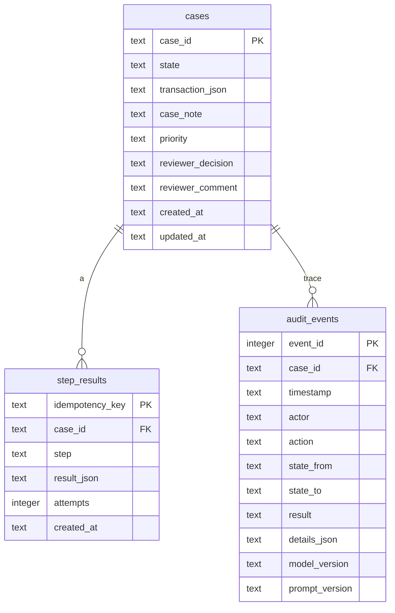

### 10.2 Tables
#### cases
| Colonne | Type | Contraintes | Rôle |
|---|---|---|---|
| case_id | TEXT | PRIMARY KEY | ID synthétique du cas — bloque la double soumission (D-07) |
| state | TEXT | NOT NULL, une des 11 valeurs de `CaseState` | État courant ; changé seulement via `state_machine.py` |
| transaction_json | TEXT | NOT NULL | Variables vérifiées du cas (jamais l'étiquette) |
| case_note | TEXT | NULL | Note synthétique — donnée non fiable |
| priority | TEXT | NULL | Priorité calculée par `routing_policy.py` |
| reviewer_decision | TEXT | NULL, `CLOSED` / `ESCALATED` / `NEEDS_MORE_INFORMATION` | Décision humaine |
| reviewer_comment | TEXT | NULL | Commentaire facultatif |
| created_at / updated_at | TEXT (ISO 8601, UTC) | NOT NULL | Horodatages |

#### step_results
| Colonne | Type | Contraintes | Rôle |
|---|---|---|---|
| idempotency_key | TEXT | PRIMARY KEY, `"{case_id}:{step}"` | Empêche de rejouer une étape réussie (D-07) |
| case_id | TEXT | NOT NULL, FOREIGN KEY → cases | |
| step | TEXT | NOT NULL (`score`, `evidence`, `draft`, `validation`) | |
| result_json | TEXT | NOT NULL | Résultat stocké (score officiel, preuves, brouillon, raisons de validation) |
| attempts | INTEGER | NOT NULL, ≥ 1 | Nombre d'essais utilisés |
| created_at | TEXT | NOT NULL | |

#### audit_events
| Colonne | Type | Contraintes | Rôle |
|---|---|---|---|
| event_id | INTEGER | PRIMARY KEY AUTOINCREMENT | Ordre des événements |
| case_id | TEXT | NOT NULL, FOREIGN KEY → cases | |
| timestamp | TEXT | NOT NULL (ISO 8601, UTC) | |
| actor | TEXT | NOT NULL (`system`, `tool:<nom>`, `llm`, `validator`, `reviewer`) | Qui a agi |
| action | TEXT | NOT NULL | Ex. `transition`, `tool_call`, `retry`, `review_decision`, `invalid_transition` |
| state_from / state_to | TEXT | NULL | Pour les transitions |
| result | TEXT | NOT NULL (`ok`, `failed`, `rejected`, `timeout`) | |
| details_json | TEXT | NULL, **jamais de secret** | Raisons, essai n°, latence, nombre de jetons |
| model_version / prompt_version | TEXT | NULL | Traçabilité du modèle et du gabarit |

Les événements d'audit ne sont jamais modifiés ni supprimés (`audit_repository.py` ne fait qu'ajouter).

### 10.3 Ce qui n'est PAS en base
- Preuves synthétiques : `data/demo/evidence_store.json` (versionné, généré par script)
- Cas de démo à charger : `data/demo/cases.json` (versionné, généré par script)
- Modèle et métadonnées : `artifacts/models/` (non versionné, régénéré par `python -m src.train`)
- Secrets : `.env` seulement (non versionné), modèle dans `.env.example`
- Données brutes PaySim : `data/raw/` (non versionné)

---

*Prochaine étape après validation :*
1. *mettre à jour `Syllabus_Mapping.md` si besoin (les noms des couches sont inchangés : aucune mise à jour nécessaire) ;*
2. *Erman crée et pousse le dépôt GitHub (P-01) ;*
3. *fin de ce chat M2 ;*
4. *premier chat M3, Jalon 2, à partir du fichier 01.*

---

## VALIDATION
| Rôle | Nom | Date |
|---|---|---|
| Préparé par | Tensoratech (Claude, chat M2) | 2026-10-20 |
| Validé par (v1.0) | Erman | 2026-10-20 |
| Modifié (v1.1) — source unique du seuil et des bornes | Tensoratech (Claude, chat M3 J1), sur décision d'Erman (I20) | 2026-11-04 |

## ÉCARTS AVEC LE GABARIT
- **Sections ajoutées** :
  - la VALIDATION et ce bloc ÉCARTS, absents du gabarit 06 alors que le rituel les exige pour chaque document ;
  - un encadré « choix tranchés par Erman » en tête ;
  - une ligne « Entraînement » dans les §5 et §8 ;
  - un décompte des tests sous le registre.
- **Sections marquées « ne s'applique pas »** : aucune (§10 s'applique : SQLite).
- **Questions « ne dit pas encore »** : le gabarit 06 n'a pas cette section. J'ai posé avant la génération les 4 choix techniques laissés ouverts par l'énoncé et le Document maître (UI, DL, LLM, stockage).
- **Ambiguïtés du gabarit** :
  - (a) l'arborescence d'exemple (backend / frontend) ne convient pas à un projet ML + Streamlit : remplacée par la structure de l'énoncé §16 ;
  - (b) le gabarit place les dépôts et les adaptateurs en couche 2, alors que le guide IA réserve l'appel au LLM à la couche 4 : l'adaptateur LLM est en couche 4 (règle IA, plus précise) ;
  - (c) le gabarit ne dit pas comment inscrire au registre les **fichiers générés** (figures, artefacts) : une ligne par producteur, chaque fichier étant nommé au §7 ;
  - (d) pas de colonne « Statut » adaptée au palier Noté : on y met les jalons.

